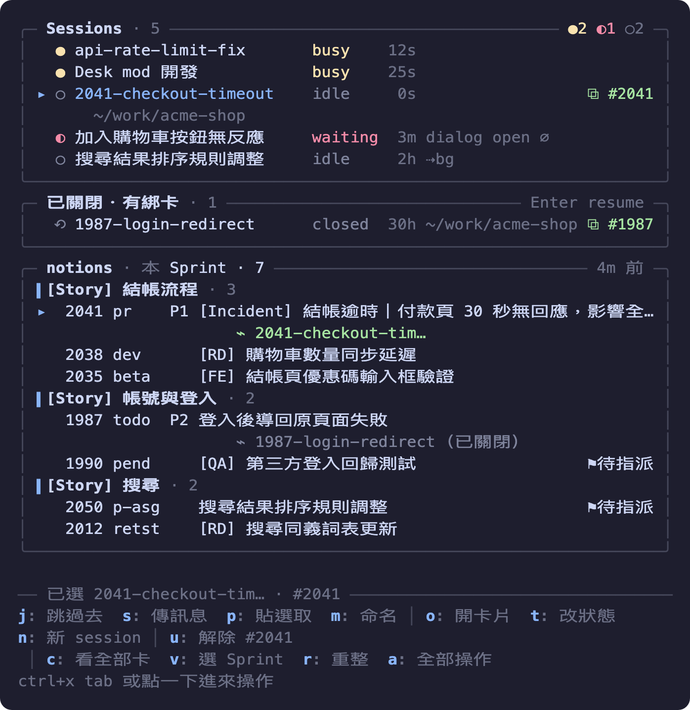
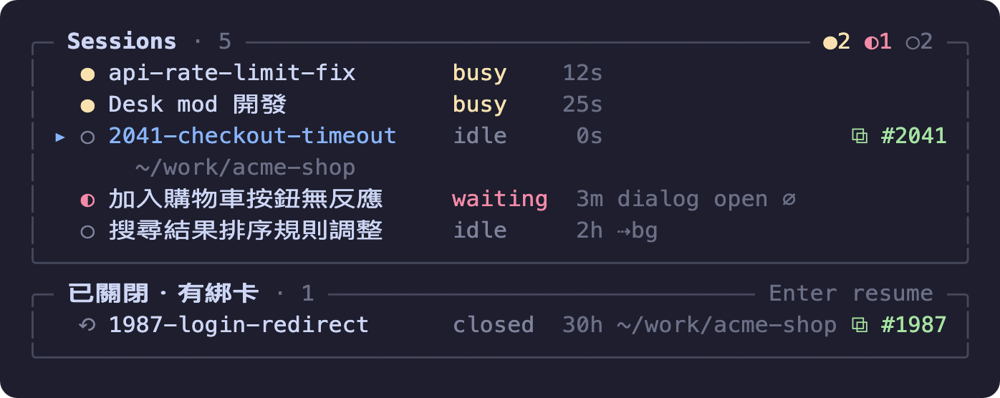
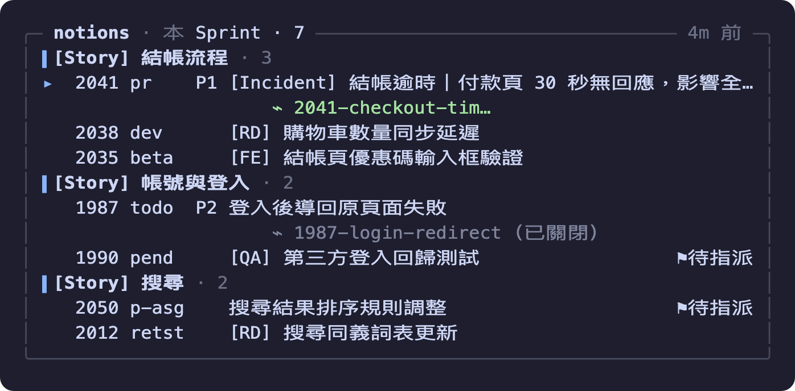
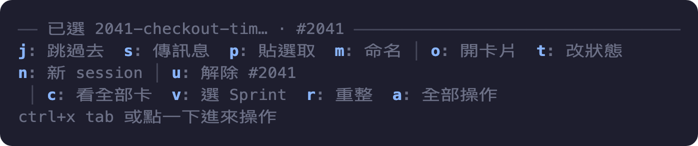

# session-desk — Claude Code 的 Session 總管

一個開在 Claude Code 右側的 pane，回答三個問題：

1. **這台機器上哪些 Claude Code session 在跑、誰在等我？** busy／idle／waiting 一眼看完，`j` 直接跳到那個 iTerm2 分頁，或把一段 context 送過去。
2. **Notion Sprint Board 上哪些卡是我的？** 指派給我或 owner 有我、還沒結案的卡，依 Story 分組；可以在 Notion app 開、改 Status、用它開新 session。
3. **哪個 session 在做哪張卡？** 兩邊綁在一起，session 關掉後還記得，`j` 就 resume 回來。



> 圖是用 `docs/make-demo.py` 從真實畫面產生的（it2 抓文字、渲染、Chrome 截圖），改版面後跑一次就能更新。

## 安裝

### 從 GitHub（推薦）

在 Claude Code 的輸入框：

```
/plugin install session-desk --marketplace howard60915/cc-mods
```

第一次會問「Add marketplace?」答 `y`，scope 選 user。接著會列 4 個設定項（配色、自動開 pane、Notion view、it2 路徑），全部留預設即可，之後都能在 `/plugin` 裡改。裝完當下就載入，不用重開。

shell 版：`claude plugin install session-desk --marketplace howard60915/cc-mods`。

私有 repo：裝的人要能讀它，機器上要有 github.com 的 git 憑證（`gh auth login` 後 `gh auth setup-git`）。

### 本機資料夾（自己改程式用）

```
git clone https://github.com/howard60915/cc-mods.git ~/Howork/cc-mods
claude plugin marketplace add ~/Howork/cc-mods
claude plugin install session-desk
```

Claude Code 直接讀 `~/Howork/cc-mods/session-desk`，改完檔案在任一 session 打 `/reload-plugins` 就生效。只想試一個 session：`claude --plugin-dir ~/Howork/cc-mods/session-desk`，存檔即熱重載。

## 裝完要做的三件事

### 1. 放行兩個 Notion 唯讀工具

mod 從計時器發的 Notion MCP 呼叫會被 Claude Code 的 auto mode 分類器擋下（因為沒有對應的使用者請求可判定）。在 `~/.claude/settings.json` 的 `permissions.allow` 加：

```json
"mcp__plugin_Notion_notion__notion-query-data-sources",
"mcp__plugin_Notion_notion__notion-search",
"mcp__plugin_Notion_notion__notion-fetch"
```

或在 Claude Code 打 `/permissions` 用介面加。三個都是唯讀：第一個查 view（卡片、Sprint），第二個用 search 拿 Story 標題，第三個只在 search 找不到某個 Story 時才讀那一頁。改 Status 用的 `notion-update-page` 是寫入，刻意不放行；按 `t` 被擋時提示列會說，要的話再自己加。

前提：Claude Code 的 Notion plugin 已連線（`/mcp` 看得到 `plugin:Notion:notion`）。

### 2. 在 Notion 建一個自己的 view

卡片是從一個 **table view** 查的（view 模式不吃 Notion 非 Business 方案的查詢配額，rows／SQL 模式會）。在你自己的 Notion 頁面放一個 New Sprint Board 的連結資料庫，加一個 table view，篩選：

- `Assign` 包含我 **或** `owner` 包含我
- `Status` 不是 Done
- `Status` 不是 Archived

複製該 view 的網址（帶 `?v=`），填進 `/plugin` → session-desk → 「Notion view 連結」。留空會用 Howard 的 view，別人用會查到 Howard 的卡。

同一頁再放一個 **Sprints (for Scrum)** 的連結資料庫、加一個 table view，篩選 `Sprint status` 是 Last／Current／Next，網址填進「Sprints view 連結」。mod 靠它知道哪個是本 Sprint，一天查一次；不建的話用 Howard 的，通常一樣。

為什麼都用 view 而不是讀頁面：Notion plugin 的 `notion-fetch` 只有「整頁」一種讀法，Sprint 頁掛著幾百張 Tasks、Story 頁可能是整本 bug 日誌，動輒上百 KB 還可能超過 MCP 回傳上限。view 查詢與 search 只回需要的欄位。

### 3. iTerm2

跳分頁、開新分頁、改分頁名都靠 iTerm2 的 `it2` CLI（`/Applications/iTerm.app/Contents/Resources/utilities/it2`，路徑可在設定改）。用別的終端機時列表照常，只是這幾個動作不能用，對不到分頁的 session 會標 `⌀`。

## 怎麼用

### 開 pane、進出焦點

- 終端寬度 144 欄以上時每個 session 啟動會自動開在右側（可在設定關掉）；或打 `/desk`。
- 鍵盤要進 pane：`ctrl+x tab`。想要單鍵可以在 `~/.claude/keybindings.json` 加 `{"context":"Chat","bindings":{"ctrl+shift+d":"abovePrompt:focus"}}`。
- `Esc` 回輸入框、`ctrl+x x` 關 pane、`ctrl+x ←／→` 調寬度。滑鼠點列也可以。

### 快捷鍵一覽

pane 拿到鍵盤後才有效。操作列是情境式的：沒選到對象的鍵不會顯示、按了也沒反應，`a` 可以切成完整清單。

| 鍵 | 對象 | 做什麼 |
|---|---|---|
| `↑` `↓` `Tab` | — | 在列與按鈕間移動 |
| `Enter` | session／卡 | 只選取（列首出現 ▸）；已選到的 session 再按一次＝跳過去（已關閉的＝resume） |
| `j` | 選到的 session | 跳到它的 iTerm2 分頁；已關閉的 session 則開新分頁 `claude --resume` |
| `s` | 選到的活 session | 切成「傳訊息」畫面，Enter 送出、`\` 加 Enter 換行、送出空白或 Tab 到「取消」＝不送 |
| `p` | 選到的活 session | 把滑鼠選取的文字帶進傳訊息畫面（註明來源），可補說明再送 |
| `m` | 選到的 session | 取別名（pane、iTerm2 分頁名跟著改；留空清掉） |
| `o` | 選到的卡 | 在 Notion 桌面 app 開（沒 app 退回瀏覽器） |
| `t` | 選到的卡 | 改 Status（選單；要放行 `notion-update-page` 才寫得回去） |
| `n` | 選到的卡 | 在 iTerm2 開新分頁、同目錄起 `claude`，開場 prompt 就是這張卡 |
| `b` | session＋卡都選到 | 綁定；已綁別張時變「改綁」 |
| `u` | 綁著卡的 session | 解除綁定 |
| `c` | — | 「本 Sprint」與「全部卡」切換 |
| `v` | — | 選單挑特定 Sprint |
| `r` | — | 強制重抓卡片與 Sprint／Story 標題 |
| `a` | — | 操作列精簡／完整清單切換 |
| `Esc` | — | 把鍵盤還給輸入框（pane 留著） |
| `ctrl+x tab` | — | 鍵盤進 pane（或自己綁的快捷鍵，例如上面的 `ctrl+shift+d`） |
| `ctrl+x x` | — | 關 pane |
| `ctrl+x ←／→` | — | 調 pane 寬度 |

### 看狀態



上圖：兩個 busy、一個 waiting（後面寫它在等什麼）、兩個 idle；選到的那列（▸）多一行顯示目錄；`⧉ #2041` 表示它綁著那張卡；`⇢bg` 是 park 出去的背景工作；`⌀` 對不到 iTerm2 分頁。下方「已關閉・有綁卡」是關掉但還綁著卡的 session，選到按 `j` 就 resume。

| 符號 | 意思 |
|---|---|
| `●` busy | 正在跑 |
| `◐` waiting | 在等你（後面接在等什麼，例如 `dialog open`） |
| `○` idle | 閒著，後面是閒了多久 |
| `⇢bg` | 這是 park 出去的背景工作，已和它的互動層合成一列；選到會多一行寫互動層在等 |
| `⌀` | 對不到 iTerm2 分頁，`j` 跳不過去 |
| `⧉ #9983` | 這個 session 綁著那張卡 |
| `⟲ … closed` | 已關閉但還綁著卡的 session，`j` 開新分頁 `claude --resume` |

waiting 的排最上面，再 busy、再 idle。名字的優先序：Desk 別名 > `/rename` 取的 > iTerm2 分頁標題（Claude 自動產生的 session title）> 系統派的 `pluto-ff`。

### 跳過去、傳 context

- 方向鍵走到 session 按 **Enter**：只是選取（列首出現 ▸），不會跳走；已選到的那列再按一次 Enter，或按 **`j`**，才切到它的 iTerm2 分頁。
- **`s` 傳訊息**：Desk 整個 pane 換成「傳訊息」畫面，上面寫收件 session 的名稱、路徑與忙閒狀態，下面是多行輸入框。Enter 送出、`\` 加 Enter 換行；要取消就送出空白，或 Tab 到「取消」按 Enter。對方把它當一則 peer 訊息排進對話，回覆會回來；結果顯示在 Desk 最下面的提示列。
- **`p` 貼選取**：先用滑鼠在對話區選一段文字（錯誤、log、結論），再選到目標 session 按 `p`，同一個畫面打開並已帶入那段文字（註明來源），可以在後面補一句說明再送。選取只在按鍵當下有效，中間別按別的鍵。
- 收件 session 的權限模式跟你不同時，引擎會把訊息扣住等對方批准，對方畫面上會看到一則待批准的跨 session 訊息；這邊仍顯示「已送給」。
- **`m` 命名**：取別名，pane 顯示、iTerm2 分頁名都跟著改；命名的是這個 session 本身時，下一句 prompt 送出後 Claude 自己的 session 名稱也會改。留空送出清掉別名。

### 卡片



上圖：卡片依 Story 分組；每列是卡號、狀態短寫、優先度、標題；`⚑待指派` 是 Assign 空著、只有 owner 列到你的卡；卡列下的 `⌁ …` 是綁著它的 session（「（已關閉）」表示那個 session 已經關了）。

- notions 區依 **Story** 分組，組名是 Story 頁標題；沒 Story 的在最後一組。第一次載入組名可能短暫是 `Story xxxxxx`，標題抓回來就換掉。
- 列：`卡號 狀態短寫 優先度 標題`。狀態短寫：`todo` Not started、`pend` Pending、`p-asg` Pending Assignment、`dev` In Development、`pr` PR Reviewing、`beta` Wait to Beta、`prod` Wait to Prod、`retst` PM Retest。`⚑待指派` 表示 Assign 是空的、只有 owner 列到你。
- 選到卡（Enter 或點）後：**`o`** 在 Notion 桌面 app 開（`notion://`，app 不在就退回瀏覽器）、**`t`** 改 Status（跳選單，選完寫回 Notion；需要在 `permissions.allow` 放行 `mcp__plugin_Notion_notion__notion-update-page`，沒放行會被 auto mode 擋下）、**`n`** 在 iTerm2 開新分頁、同目錄起 `claude`，開場 prompt 就是這張卡。
- 範圍：**`c`** 在「本 Sprint」與「全部」間切換；**`v`** 跳選單挑特定 Sprint（名單是你卡上出現過的 Sprint）。**`r`** 強制重抓卡片與 Sprint／Story 標題。

### 綁定：哪個 session 在做哪張卡

- 選一個活著的 session（Enter）和一張卡（Enter），按 **`b`**。session 列尾出現 `⧉ #卡號`，卡列下出現 `⌁ session 名`。已綁別張時 `b` 變成「改綁」。
- **`u`** 解除。
- 綁定存在 plugin store，所有 session 共用。session 關掉後移到「已關閉・有綁卡」，選到按 `j`（或再按一次 Enter）會在 iTerm2 開新分頁、回原目錄 `claude --resume <id>`（transcript 不在就只提示）。綁的卡 Done／Archived／改指派後自動清掉。
- 綁定記的名稱與目錄會跟著活著的 session 走：session 改名（含別名）或搬到新 worktree，下一輪重整就更新。目錄已經刪掉（`git worktree remove`）的綁定，列尾標「目錄已刪」；resume 時自動退回最近的上層或去掉 `-後綴` 的主 repo（例如 `acme-shop-2041` → `acme-shop`），transcript 仍在原目錄的紀錄裡，從別的目錄 `--resume` 一樣找得到。

### 操作列



上圖：選到一個 session 和一張卡時的操作列。標題線寫目前選了什麼；第一組是 session 的操作、第二組是卡片的、`u` 是因為這個 session 已綁著卡才出現；最後一組永遠都在。

情境式：選到 session 才列 session 的鍵，選到卡才列卡的，兩邊都選到才有 `b`。沒顯示的鍵按了沒反應。按 **`a`** 切成四行的完整清單（Session／卡片／綁定／檢視），再按一次回精簡。

## 設定（`/plugin` → session-desk）

| 項目 | 說明 | 預設 |
|---|---|---|
| 配色 | `Claude Code`（跟 Claude 亮暗主題）、`終端機`（ANSI 色，跟 iTerm2 profile）、或 Catppuccin／Tokyo Night／Nord／Gruvbox／Dracula／Rosé Pine／Kanagawa… 15 組色碼（有底色的會塗整個 pane） | Claude Code |
| 啟動時自動開 pane | `on`／`off`；off 時只有 `/desk` 才開 | on |
| Notion view 連結 | 「指派給我或 owner 有我、未結案」的 table view 網址（帶 `?v=`） | Howard 的 view |
| Sprints view 連結 | Sprints 資料庫上篩 Last／Current／Next 的 table view | Howard 的「Desk · Sprints」 |
| it2 路徑 | iTerm2 的 it2 CLI | `/Applications/iTerm.app/…/it2` |

設定改完若沒生效，`/reload-plugins` 或重開 session。

## 疑難排解

| 現象 | 原因與處理 |
|---|---|
| notions 區紅字 `… refused: The server-side auto mode classifier gave no verdict` 或對話區出現 `notion-fetch denied by auto mode` | 步驟 1 的放行規則沒加（或只加了一個）。加完 `r`。 |
| 紅字 `Your workspace has used up its Query Data Source allowance` | Notion 非 Business 方案的 rows／SQL 配額被吃光（約 60 分鐘重置）。本 mod 只用 view 模式，正常不會碰到；若你把 view 連結填成別的東西或同時有別的工具在查，等重置。 |
| 紅字 `ECONNRESET`／逾時 | Notion MCP 連線抖動。mod 會自動重試三次、30 秒後再補查，期間顯示上一次的清單（後面會註明）。 |
| 卡片區標題一直是「全部」、`c` 切不到本 Sprint | Sprints view 查不到（`notion-query-data-sources` 沒放行，或 view 連結填錯）。放行後 `r`。 |
| 組名停在 `Story xxxxxx` | `notion-search` 沒放行，且那頁大到讀不完（例如「[Support] 維運 / Bug issues」）；放行 search 後 `r`。 |
| pane 開不出來 | 終端寬度不到 144 欄時不會自動開；打 `/desk` 可在 110 欄以上強制開。 |
| session 列有 `⌀`、`j` 跳不過去 | 不是 iTerm2，或 `it2` 路徑不對（設定可改）。 |
| 按 `t` 改狀態被擋 | `notion-update-page` 是寫入工具，預設沒放行；要用就加進 `permissions.allow`。 |
| `s`／`p` 顯示「送不出去」 | 對方 session 已關，或這就是目前的 session。 |
| 改完程式重載後畫面掛掉、提示 `ui.render hook skipped` | 多半是 plugin store 裡的舊快取形狀不合；程式裡快取鍵帶版號，改卡片形狀時把 `cardsCache-vN` 的 N 加一。 |

## 資料從哪來

- **session**：`~/.claude/sessions/<pid>.json`（Claude Code 自己寫的：name、status、waitingFor、cwd、jobId、parkedJobId），每 5 秒讀一次；`ps` 判活；`it2 session list` 把 tty 對到 iTerm2 分頁。
- **卡片**：Notion plugin MCP 的 `notion-query-data-sources`（view 模式），結果存 plugin store 4 分鐘、所有 session 共用；每 5 分鐘重查。
- **Sprint**：同一個工具查「Desk · Sprints」view（Last／Current／Next 三筆），24 小時一次。
- **Story 名稱**：`notion-search` 限定 Story 資料庫一次拿回所有標題，24 小時一次；search 沒命中的才 `notion-fetch` 那一頁，整頁太大讀不完的記 24 小時不再試。
- **綁定、別名**：plugin store（`$.store`），跨 session 共用，不隨 session 結束消失。

## 開發

```
claude plugin validate .
npx -y -p typescript tsc -p .        # 型別由引擎鋪在 .claude-plugin/types/，第一次載入後才有
claude plugin test .
```

| 檔案 | 內容 |
|---|---|
| `hooks/register.tsx` | 畫面與所有 `$` 呼叫（session 刷新、Notion 查詢、動作、render） |
| `hooks/model.ts` | 純函式：解析 sessions json／ps／it2、Notion row → Card、名字優先序、park 合併、寬度工具（有測試） |
| `hooks/themes.ts` | 配色表 |
| `types/index.d.ts` | `$.state` 的型別契約；改值的形狀時把該 atom 的 `shape` 版號加一，舊值才會被丟掉 |
| `hooks/model.test.ts` | `claude plugin test` 跑的測試 |

改完 `/reload-plugins` 看效果，commit 後 `git push`。

### 重做 README 的 demo 圖

```
cd session-desk/docs
python3 make-demo.py                 # 抓「目前 active 的 iTerm2 分頁」的 pane 畫面
python3 make-demo.py --from pane-sample.txt   # 不抓畫面，用上次存的文字重畫
```

流程：`it2 session capture` 抓終端文字 → 依顯示欄寬切出 pane → `render.py` 依內容上色畫成 SVG → Chrome headless 以 2x 截成 PNG。先把 pane 開著、選一列 session 和一張卡再跑，圖才有選取與操作列。不用安裝任何套件（只靠 iTerm2 與 Chrome）。

**資料來源是 `pane-sample.txt`，內容是虛構的（acme-shop、#2041 之類），不是真實看板。** 不要用 `make-demo.py`（不帶 `--from`）抓真實畫面直接 commit：那會把公司 Notion 的卡號、標題、session 名寫進圖裡。要改示意內容就改 `pane-sample.txt`（每列要補空白到同一欄寬，CJK 算 2 格）再 `--from` 重畫。
